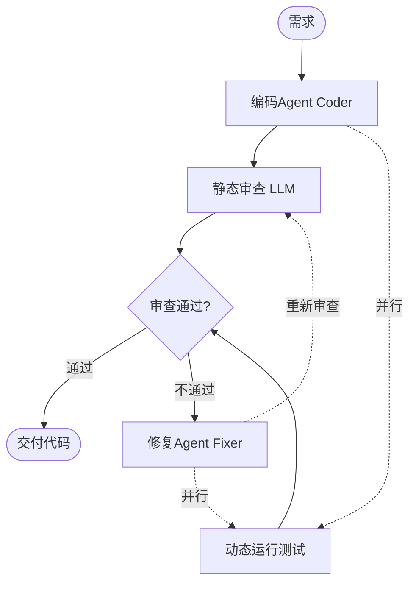
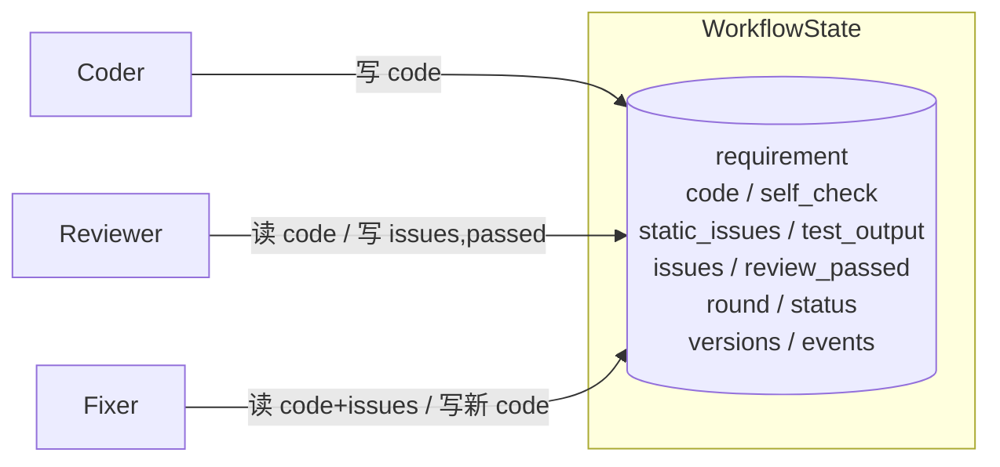

# Code Review Workflow —— 3-Agent 协作工作流

一个由 **3 个 Agent 协作**完成「编码 → 审查 → 修复」的工作流引擎，配套**可视化编排界面**。用于理解 Workflow 编排、Agent 间通信、状态管理，并实现条件分支、循环、并行、检查点恢复等高级流程控制。

- **编码 Agent（Coder）**：根据需求生成初版代码与自检断言
- **审查 Agent（Reviewer）**：**并行**执行「静态 LLM 审查」与「动态运行测试」，合并裁决是否通过
- **修复 Agent（Fixer）**：按审查问题清单修复代码，再送回审查（回环）

---

## 1. 功能特性

| 类别 | 能力 |
|------|------|
| 流程完整性 | 3 Agent 端到端跑通：编码 → 审查 →（不通过→修复→复审）→ 交付 |
| Agent 协作 | 黑板模式共享状态；结构化 JSON 作为 Agent 间消息协议；代码版本留痕 |
| 高级流程控制 | 顺序执行、**条件分支**、**循环回环**、**并行 fan-out/fan-in** |
| 可观测性 | 每节点开始/结束/耗时/状态事件，控制台 + `trace.json` + Web 时间线 |
| 错误处理 | LLM 指数退避、JSON 纠错重试、节点级重试、线程级兜底 |
| 恢复机制 | 每节点后落**检查点**，失败/中断后可 `resume` 从断点继续 |
| 可视化 | Flask Web 编排台：流程图、实时节点状态、发起/恢复运行、历史记录 |
| 离线演示 | MockLLM 无需 API Key 即可演示含并行与回环的完整流程 |

---

## 2. 工作流程图



执行层的实际节点更粗（`review` 节点内部并行跑两个分支），视图层把并行分支、条件菱形和回环都画出来。

---

## 3. 架构设计

### 3.1 分层

```
┌──────────────────────────────────────────────┐
│  交互层   run.py (CLI)   app.py (Flask Web)    │
├──────────────────────────────────────────────┤
│  编排层   WorkflowEngine                       │
│           顺序边 / 条件路由 / 循环 / 节点重试    │
│           检查点落盘 / 恢复                     │
├──────────────────────────────────────────────┤
│  节点层   BaseNode → Coder / Reviewer / Fixer  │
│           ParallelNode（线程并行 + 容错合并）    │
├──────────────────────────────────────────────┤
│  状态层   WorkflowState（黑板）+ RunStore       │
├──────────────────────────────────────────────┤
│  基础层   common.llm (OpenAI/Mock)  tools/*     │
└──────────────────────────────────────────────┘
```

### 3.2 Agent 间通信：黑板模式 + 结构化契约

3 个 Agent **不直接互相调用**，都读写同一个 `WorkflowState`，由引擎按图调度，从而解耦、便于增删节点。



- **消息协议**：Coder/Fixer 输出 `{code, self_check, note}`；静态审查输出 `{issues:[{severity,desc}], summary}`；Fixer 直接消费 `issues` 逐条修复。
- **单一事实来源**：`code` 始终是当前代码；每次修改写入 `versions`，可回溯到作者（coder/fixer）与轮次。

### 3.3 并行执行（fan-out / fan-in）

`review` 节点用 `ThreadPoolExecutor` 并发执行两个分支：

| 分支 | 类型 | 产出 |
|------|------|------|
| 静态审查 | LLM 调用（慢、I/O 阻塞） | `static_issues` |
| 动态测试 | 子进程 `run_python`（code + self_check） | `test_output`、`tests_passed` |

真实模式下 LLM 网络等待与子进程执行**重叠**，缩短总耗时。任一分支异常不影响另一分支（容错 fan-out），错误进入合并步骤。

**合并裁决规则**：动态测试通过 **且** 静态无 `major` 问题 → `review_passed=True`。

### 3.4 条件分支与循环

- 路由表中每个节点可配「固定下一节点」或「路由函数」；
- `review` 的路由函数：通过 → `END`；不通过且未达 `MAX_ROUNDS` → `fixer`；达到轮次上限 → 优雅结束（`passed=False`，不无限循环）；
- `fixer` 固定回到 `review`，形成回环。

### 3.5 检查点与恢复

- 每个节点完成并确定下一节点后，`RunStore` 把完整状态写入 `runs/<run_id>/checkpoint.json`，事件写入 `trace.json`，并记录 `next_node`；
- 节点中途失败：`next_node` 仍指向该节点，恢复时重跑；
- CLI `--resume <id>` 或 Web「恢复」即可从断点继续（已验证：无 Key 失败 → demo 恢复 → 成功）。

---

## 4. 目录结构

```
02CodeReviewWorkflow/
├── run.py                  # CLI 入口
├── app.py                  # Flask Web 可视化服务
├── requirements.txt
├── .env.example
├── common/
│   ├── config.py          # 配置加载
│   ├── llm.py             # OpenAI/Mock LLM + 重试 + JSON 纠错
│   └── logging_utils.py
├── tools/
│   ├── python_runner.py   # 子进程执行 Python（超时）
│   ├── file_reader.py     # 安全读文件（防路径逃逸）
│   └── code_search.py     # 代码搜索
├── workflow/
│   ├── state.py           # WorkflowState / Event / CodeVersion
│   ├── base_node.py       # BaseNode / ParallelNode
│   ├── engine.py          # WorkflowEngine（编排/重试/检查点）
│   ├── trace.py           # RunStore（持久化）
│   └── review_flow.py     # 流程定义（节点/路由/视图布局）
├── agents/
│   ├── coder.py
│   ├── reviewer.py        # 含并行分支与合并
│   ├── fixer.py
│   └── prompts.py
├── templates/index.html   # Web 前端
├── static/style.css, app.js
├── runs/                  # 检查点（运行时生成）
└── tests/test_workflow.py
```

---

## 5. 快速开始

### 5.1 环境

```powershell
cd D:\desktop\SE\work\02CodeReviewWorkflow
python -m venv .venv
.\.venv\Scripts\Activate.ps1
pip install -r requirements.txt
```

### 5.2 CLI

```powershell
# 离线演示（无需 Key，含并行 + 回环）
python run.py --demo

# 单次运行
python run.py --demo --once "实现一个斐波那契函数 fib(n)"

# 关闭并行 / 调整轮次
python run.py --demo --no-parallel --rounds 2 --once "实现二分查找"

# 历史与恢复
python run.py --list
python run.py --resume <run_id>
```

### 5.3 接入真实模型

```powershell
copy .env.example .env   # 填入 OPENAI_API_KEY（兼容 DeepSeek/Kimi/通义千问，见 .env.example）
python run.py
```

### 5.4 可视化 Web 编排台

```powershell
python app.py
# 浏览器打开 http://127.0.0.1:5000
```

在左侧填写需求、选择「离线演示 / 启用并行 / 最大轮次」，点击运行；流程图节点会按实时状态变色，底部查看执行日志、代码、问题清单与测试输出；失败后可一键恢复，也可点击历史运行回看。

---

## 6. 配置项（.env）

| 变量 | 默认 | 说明 |
|------|------|------|
| `OPENAI_API_KEY` | 空 | API 密钥 |
| `OPENAI_BASE_URL` | openai | OpenAI 兼容地址 |
| `MODEL_NAME` | gpt-4o-mini | 模型名 |
| `MAX_ROUNDS` | 3 | 审查循环上限 |
| `NODE_RETRIES` | 2 | 单节点失败重试次数 |
| `MAX_RETRIES` | 3 | LLM 调用重试次数 |
| `CODE_TIMEOUT` | 10 | 代码执行超时（秒） |
| `ENABLE_PARALLEL` | true | 是否并行审查 |
| `WORKSPACE` | ./sandbox | 代码执行/文件根目录 |
| `RUNS_DIR` | ./runs | 检查点目录 |
| `WEB_PORT` | 5000 | Web 端口 |

---

## 7. Web API

| 方法 | 路径 | 作用 |
|------|------|------|
| GET | `/api/graph` | 流程图节点/边/布局 |
| POST | `/api/run` | 发起运行，body：`{requirement, demo, parallel, max_rounds}` |
| GET | `/api/run/<id>` | 查询状态与事件（轮询） |
| GET | `/api/runs` | 历史运行列表 |
| POST | `/api/run/<id>/resume` | 从检查点恢复，body：`{demo}` |

---

## 8. 测试

```powershell
python tests/test_workflow.py
```

覆盖：视图结构（并行/条件/回环）、完整并行流程（2 轮通过）、顺序模式、最大轮次优雅终止、检查点落盘与 resume 恢复、工具错误捕获。

---

## 9. 可扩展性：新增一个 Agent / 节点

引擎与具体角色完全解耦，新增节点（例如「测试 Agent」「安全扫描 Agent」）只需：

1. 继承 `BaseNode`，实现 `run(state) -> patch`；
2. 在 `review_flow.build_pieces` 注册节点，并在 `routing` 中加入边或路由函数；
3. 若要在视图显示，在 `view_graph()` 加节点坐标与边。

无需改动引擎。并行只需把多个分支交给 `ParallelNode` 并提供 `merge`。